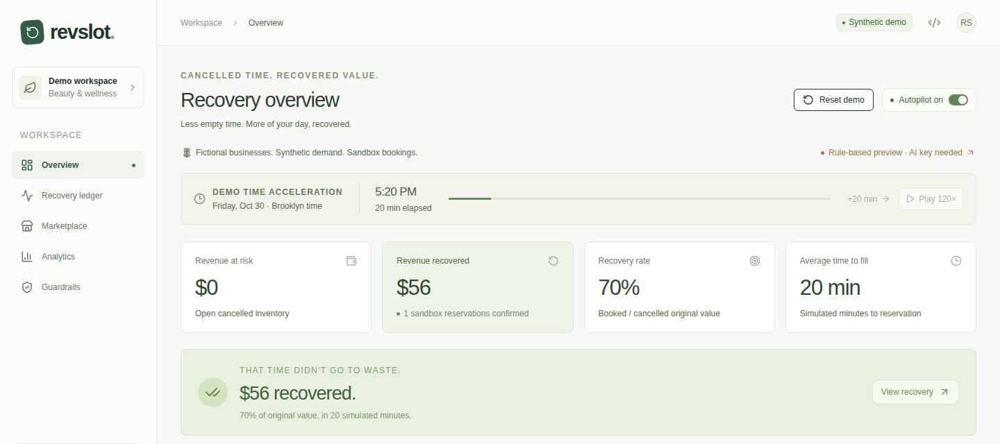
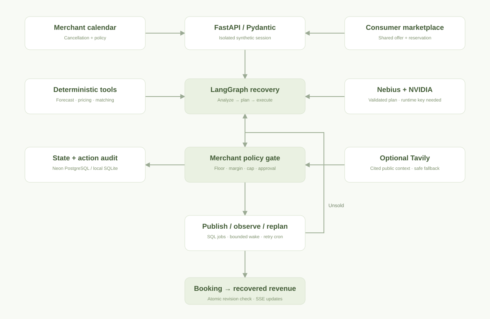

# Revslot

**An autonomous revenue recovery agent for cancelled beauty and wellness appointments.**

Cancelled time. Recovered value.

[Source](https://github.com/yimtaegyun/revslot) · [Browser evidence](demo/README.md) · [Architecture](docs/ARCHITECTURE.md) · [Evaluation](docs/EVALUATION_REPORT.md) · [Demo script](demo/VIDEO_SCRIPT.md) · [Submission draft](demo/DEVPOST.md)

**Build status:** [CI passed](https://github.com/yimtaegyun/revslot/actions/runs/40064620041): 34 Python tests, production build/TypeScript and 3 complete browser tests. Nine actual screenshots and the raw browser recording are included. Live Nebius/NVIDIA inference, Tavily, public deployment and the final submission take remain gates. The no-key mode is an explicitly labeled **deterministic preview**, not live AI or a finished eligible submission. [Current state](PROJECT_STATE.md).



## Problem and existing solutions

An 8 PM appointment cancelled at 5 PM is inventory with three hours left to recover value. Once it starts, that inventory cannot be sold. We focus on beauty and wellness; medical appointments are excluded.

Waitlists and yield management already exist. ClassPass describes ML demand protection and price/conversion/expected-revenue optimization; Fresha and other booking products automate substantial workflows. Our experiment is a merchant-visible cancellation loop coordinating price, audience, channel, policy, monitoring and booked-revenue attribution. [Competitor evidence](research/COMPETITOR_MATRIX.md).

## One complete workflow

1. Cancel the fictional $80, 8 PM massage in the merchant calendar.
2. LangGraph evaluates full-price natural fill and eight candidate discounts.
3. A deterministic tool selects the permitted expected-revenue maximum; policy checks floor, cost + margin, cap, confidence and approval.
4. Twelve opted-in synthetic profiles within 3 km are ranked. One shared $64 offer appears in the marketplace and sandbox inbox records.
5. Advance 20 demo minutes without booking. The workflow observes actual unsold application state, then reassesses. The seeded preview expands to 6 km / 24 profiles and chooses $56.
6. Confirm the consumer reservation. An atomic update recovers the slot and changes booked gross revenue to $56: 70% of original slot value.

These are calculated results. The natural-fill percentage comes from the fitted model, not the brief’s illustrative 18%. No payment or real message is sent. Play mode advances 20 simulated minutes every ten real seconds and is visibly labeled.

## Agent architecture



Three LangGraph nodes implement six responsibilities: demand, orchestration, pricing strategy, matching, recovery operation and outcome. They share state rather than spawning redundant chatbots. Validated `publish`, `expand`, `wait`, `recommend` actions control execution; malformed responses fail closed. A live model can change whether to wait, publish, widen reach or request review.

NVIDIA interprets context, selects an allowed plan and drafts a nonnumeric headline/short public summary. Python computes every price, forecast, rank, policy check and metric. The UI shows actual tools/actions, never provider reasoning fields. [Workflow](docs/AGENT_WORKFLOW.md).

## Pricing engine

`Expected revenue = shared price × predicted remaining-horizon fill probability`.

The synthetic forecast uses a complementary-log-log time-to-arrival model with fixed log(time) offset. Candidate discounts range from 0% to 40%. Integer-cent prices must exceed the merchant floor and cost + minimum margin. Likely natural full-price demand can prohibit discounting. Ties prefer less discount.

This is a deterministic **myopic** objective, not a guarantee of optimal lifetime revenue. Randomized synthetic treatments are not production elasticity evidence. The confidence gate is a training-range support heuristic, not a calibrated probability of correctness. [Model card](docs/PRICING_ENGINE.md).

## Marketplace and human control

Consumers see service, fictional merchant, original/current price, discount, demo distance, start time and remaining demo minutes. Every customer gets the same slot price. Ranking changes notification priority only. No sensitive attributes, real PII, reviews, partners or user counts are invented.

Merchants control autopilot, floor, cap, margin, reach, repricing and review thresholds. Approval binds to an exact offer revision and cannot override money constraints. Stale prices and double booking return conflicts. SQLite transactions protect local state; PostgreSQL supports durable hosted state. [Guardrails](docs/SAFETY_AND_GUARDRAILS.md).

## Evaluation

The [full comparison](docs/EVALUATION_REPORT.md) reports four baselines, fill, gross revenue, discount, time, margin, unnecessary discount, paired intervals and elasticity sensitivity. A final independent-seed run uses **1,000 synthetic cancellation scenarios** after policy freeze; failed development results are retained.

The policy is not made to win every metric. It collects more gross dollars than fixed 20% in the final synthetic run, but discounts more on average, takes longer conditional on fill, and does **not** improve unnecessary discount. No LLM participates in this numerical benchmark; it does not establish a model’s business value.

## Nebius + NVIDIA

The server queries Token Factory `/models`, selects an available NVIDIA Nemotron (or validates a configured NVIDIA Nemotron ID), and requests structured JSON. Only a successful parsed response marks runtime verification. No deprecated ID is assumed; keys never enter client code.

Without a key, the labeled rules preview remains usable. Configured inference failure, invalid output or timeout produces a review-required recommendation. Catalogue + inference share a ten-second budget; optional context adds at most four seconds. **Live latency is unmeasured until credentials are connected.** [Runtime evidence](docs/RUNTIME_EVIDENCE.json).

## Tavily

Optional runtime search retrieves/caches public local-event sources and displays their URLs. Snippets are untrusted. A tiny external feature is bounded to ±0.03 and requires explicit scenario-date grounding; otherwise its price signal is zero. Failure does not break booking. Bonus readiness stays open until a real call is captured.

## Run locally

Verified environment: Python 3.12, Node 24, pnpm 11.25.0. No key is required for the labeled preview.

```bash
python -m venv .venv
.venv/bin/pip install -r requirements-dev.lock
cd frontend
corepack pnpm install --frozen-lockfile
cd ..
node scripts/dev.mjs
```

Open `http://localhost:3000`. The launcher starts Next.js and FastAPI together. Configure server environment names from [.env.example](.env.example) for live providers; this launcher does not automatically load `.env`. Never put keys in client code. Docker alternative: `docker compose up --build` (not executed in this session).

## Reproduce and test

```bash
.venv/bin/python scripts/generate_data.py
.venv/bin/python simulation/evaluate.py
.venv/bin/python -m pytest -q
cd frontend
corepack pnpm run build:vercel
corepack pnpm exec playwright install --with-deps chromium
corepack pnpm exec playwright test
```

The generator, compressed 12,000-event dataset, data card, JSON model coefficients, evaluation code and results are included. No pickle execution is needed. [QA status](docs/QA_REPORT.md) separates checks that ran from checks merely supplied.

## Stack

Next.js, TypeScript, Tailwind, shadcn button, Lucide; FastAPI, Pydantic, LangGraph, HTTPX, SQLite / PostgreSQL; SciPy fitting and scikit-learn metrics. Charts are accessible lightweight CSS visuals. Vercel Services (Beta) configuration, Docker and Playwright CI are supplied. No deployment or provider success is claimed without evidence.

## Limitations and roadmap

No merchant pilot, real calendar/POS, notifications or payments. Demo monitoring uses a browser heartbeat; durable unattended monitoring needs scheduling/queues. Production merchant authentication, abuse quotas, calibrated causal elasticity and incremental-revenue experiments remain future work. Hosted `/tmp` SQLite can reset on cold start; use PostgreSQL for durable judging access.

Next: verified runtime/public demo → opt-in beauty/wellness pilot → calendar/POS adapters → fitness/PT → restaurant/hospitality. Medical appointments remain excluded. Performance-fee/SaaS terms are hypotheses; no unsupported percentage is selected. [Competitive answers](docs/COMPETITIVE_FAQ.md).

Portfolio materials: [Korean project/resume/STAR](docs/PORTFOLIO_KO.md), [detailed development article](docs/BLOG_KO.md), [deliverable index](DELIVERABLES.md).

## License

[MIT](LICENSE). Dependencies retain their licenses. Fictional merchants are not partnerships.
