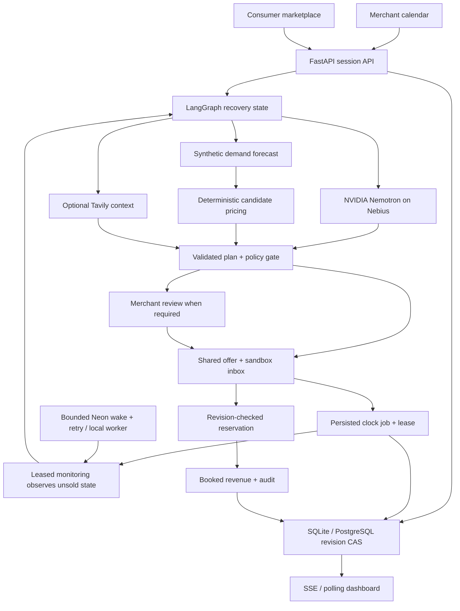

# Architecture

The frontend has no key or pricing authority. Vercel ingress routes `/api/*` to Python; the Next.js proxy supports local/separate hosting. Three graph nodes coordinate six responsibilities; these are not six independently billed models.

Each anonymous run has an unguessable HttpOnly/SameSite cookie and isolated synthetic records. A transaction updates its snapshot only if the previously read revision still matches. Competing actions/booking lose the compare-and-swap and must reload. No external charge/message occurs before commit. Sessions expire after 24 hours.

SQLite is suitable for a local process. `DATABASE_URL` selects PostgreSQL. The public deployment uses Neon PostgreSQL; a completed reservation survived redeployment. Serverless `/tmp` SQLite remains an explicitly ephemeral fallback. Provider calls occur outside database locks; a revision conflict never silently applies a stale action.

The UI receives concise tool records, not provider reasoning. Hash-linked audit entries detect accidental edits, not externally certified tampering.

| Failure | Response |
|---|---|
| Missing key | Labeled deterministic preview |
| Configured inference failure/invalid plan/timeout | Review-required recommendation |
| Tavily failure | Zero context signal; continue |
| No permitted price | Withdraw offer, blocked state |
| Matching failure | Public listing; no direct targeting |
| Stale/concurrent write | 409 and refresh |
| API offline | Readable error and retry |
| SSE failure | Polling fallback |

The standalone FastAPI lifespan owns the local worker. On Vercel, an authenticated wake starts a bounded Neon invocation calling the Python tick at a ten-second target cadence. Empty queues exit immediately; a 15-minute native cron retries interrupted work. Persisted jobs survive restarts; revision/token fences protect overlapping schedules and booking races. No browser heartbeat drives progression. Hosted scheduling is verified in [background monitoring](BACKGROUND_MONITORING.md).
